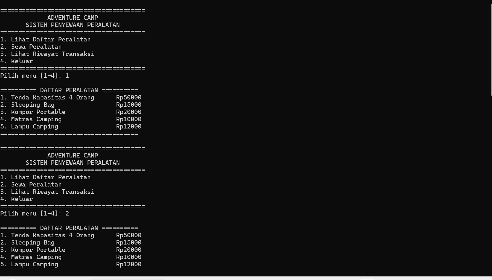
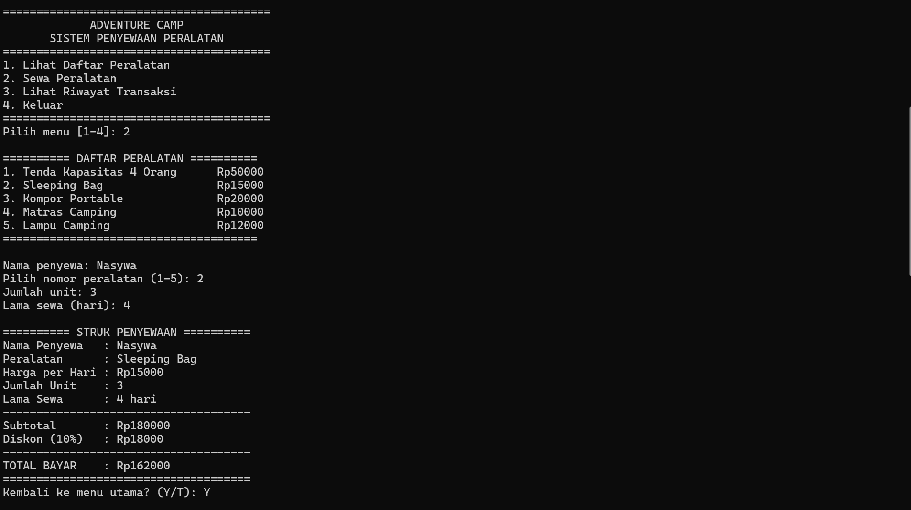
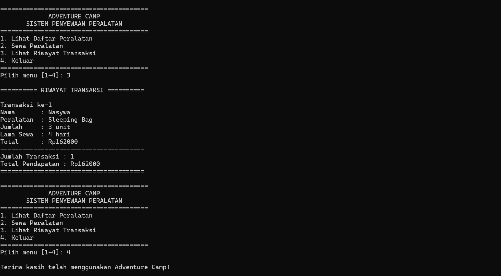

# ADVENTURE CAMP
## Sistem Penyewaan Peralatan Camping

*Nama Lengkap:* Nasywaa Naadiyatulummah
*NIM:* C2583207031
*Nama Proyek:* Adventure Camp

### Deskripsi
Adventure Camp adalah program penyewaan peralatan camping berbasis terminal. Program ini menyediakan fitur untuk melihat daftar peralatan, melakukan transaksi penyewaan, menghitung biaya sewa, dan melihat riwayat transaksi.

### Fitur Program
- Melihat daftar peralatan camping beserta harga sewa.
- Menyewa peralatan berdasarkan nama penyewa, jumlah unit, dan lama sewa.
- Menghitung subtotal, diskon, dan total pembayaran.
- Melihat riwayat transaksi dan total pendapatan.
- Keluar dari program.

### Daftar Peralatan
- Tenda Kapasitas 4 Orang — Rp50.000/hari
- Sleeping Bag — Rp15.000/hari
- Kompor Portable — Rp20.000/hari
- Matras Camping — Rp10.000/hari
- Lampu Camping — Rp12.000/hari

### Perhitungan Biaya
Program menerapkan diskon sebesar 10% dari subtotal.

Rumus:
- Subtotal = Harga per Hari × Jumlah Unit × Lama Sewa
- Diskon = 10% × Subtotal
- Total Bayar = Subtotal − Diskon

Contoh transaksi:
- Nama penyewa: Nasywa
- Peralatan: Sleeping Bag
- Jumlah unit: 3
- Lama sewa: 4 hari
- Subtotal: Rp180.000
- Diskon: Rp18.000
- **Total bayar: Rp162.000**

### Screenshot Program

#### 1. Tampilan Daftar Peralatan

#### 2. Tampilan Transaksi Penyewaan

#### 3. Tampilan Riwayat Transaksi

